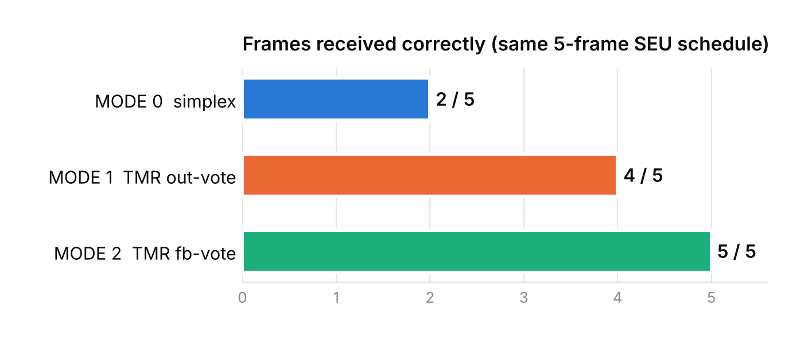
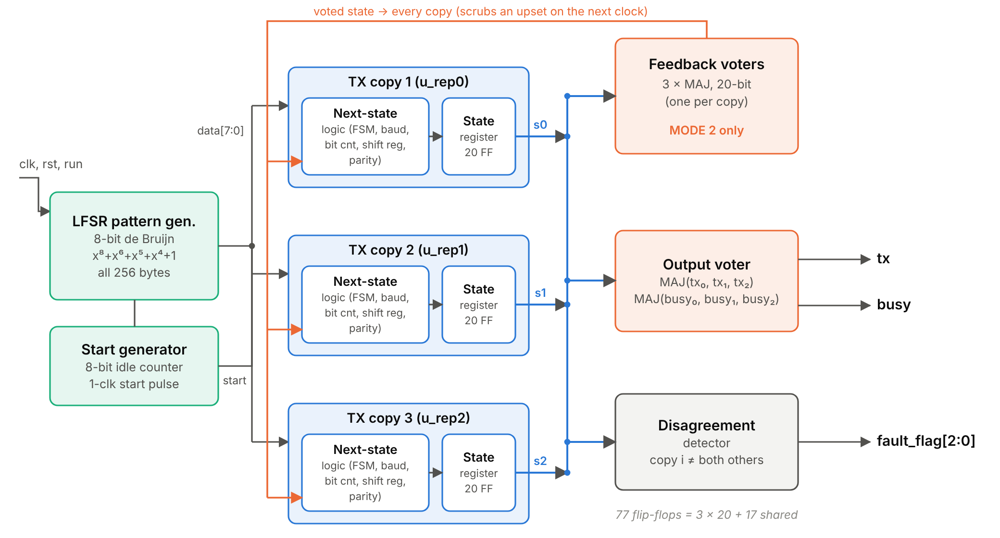
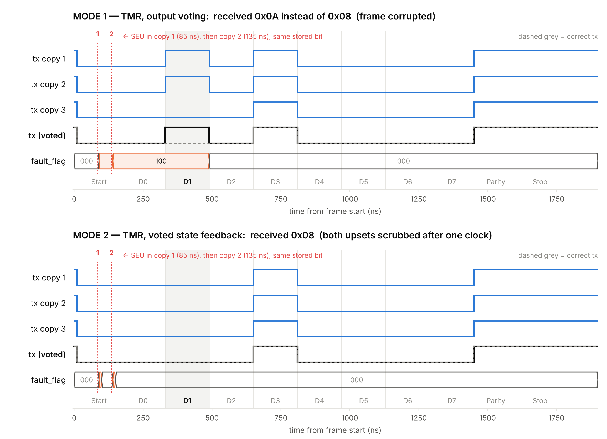

# SEU-Tolerant UART Transmitter with Voted-Feedback TMR (GPDK090)

**What happens when a cosmic ray flips a bit in your UART? With voted-feedback TMR, nothing: 5 of 5 frames survive the same upsets that corrupt 3 of 5 in an unprotected design.**

  

A UART transmitter protected against single-event upsets (SEUs) with triple modular redundancy, taken from RTL to a routed layout in the Cadence GPDK090 (90 nm) kit.

One Verilog description produces three versions through a `MODE` parameter:

| MODE | Architecture | Under the same 5 upsets |
|---|---|---|
| 0 | Simplex, no protection | 2 / 5 frames correct |
| 1 | TMR, output voting only | 4 / 5 (fails when two copies are hit at different times) |
| 2 | TMR, voted state fed back to every copy each clock | **5 / 5** |

Course project, BECE303L VLSI System Design, VIT (Fall 2026–27). Team: Aditya Manoj (24BVD0070), Arrnav Trisal (24BVD0064), Ananya Bisht (24BVD0035).

Full write-up: [`docs/TMR_UART_Report.pdf`](docs/TMR_UART_Report.pdf) (IEEE format, also as `.docx`).

## Highlights

- **No manual input.** An 8-bit de Bruijn LFSR (x⁸+x⁶+x⁵+x⁴+1) generates every byte, including 0x00; the only inputs are `clk`, `rst` and `run`.
- **Fault injection.** A 60-bit `fi_mask` port flips any replica flip-flop for one clock (removed in synthesis with `FI_PORT = 0`).
- **Fault localisation.** `fault_flag[2:0]` names the copy that disagrees with the other two.
- **Robust FSM.** Illegal state codes go to a RECOVER state; counters compare with `>=` so an upset cannot make them run away.

## Results (MODE 2 unless noted)

| | MODE 0 | MODE 1 | MODE 2 |
|---|---|---|---|
| Cell area (µm², Genus) | 1345.77 | 3593.76 | 3789.04 |
| Area vs MODE 0 | 1.00× | 2.67× | 2.82× |
| Total power (µW, Genus, vectorless) | 154.7 | 365.8 | 353.6 |
| Critical path (ns) | 2.006 | 2.110 | 2.304 |
| Flip-flops | 37 | 77 | 77 |

Sign-off of MODE 2 (raw tool reports and logs for every number here are in [`results/`](results/)):

- **Equivalence:** Conformal LEC, 91 / 91 compare points equivalent (14 outputs, 77 flip-flops).
- **Gate-level simulation:** 10 / 10 frames correct with the gsclib090 cell models.
- **Place and route (Innovus):** setup WNS +2.076 ns at 5 ns, hold WNS +0.062 ns, 0 DRC violations, clean connectivity.
- **Post-route:** 593 cells, 3826.89 µm², 527.3 µW at 0.9 V / 200 MHz.
- **Transistor-level voter:** 14-transistor static CMOS majority gate, verified in Spectre for all 8 input combinations.

Known limitation: Genus merged the three identical feedback voters into one, so the netlist has a single feedback voter. Setting `preserve` on the voter instances before synthesis fixes it. See the report for the other limitations.

## Repository layout

| Folder | Contents |
|---|---|
| `rtl/` | Synthesisable RTL. `uart_tmr_top.v` (parameterised top), `tmr_uart_tx.v`, `tx_replica.v`, `uart_tx_core.v`, `maj3.v`, `lfsr.v`, and fixed-parameter tops `uart_tmr_m0/m1/m2.v` for synthesis |
| `sim/` | Simulation-only models: UART receiver, scoreboard + MISR environment, LFSR-driven random SEU injector |
| `tb/` | `tb_directed.v` (TC1–TC8, self-checking), `tb_fi.v` (5-frame fault-injection comparison), `tb_gl.v` (gate-level test of the netlist) |
| `syn/` | `genus_tmr.tcl` (Genus synthesis), `lec_m0/m1/m2.do` (Conformal LEC) |
| `sta/` | `tempus_tmr.tcl` (Tempus STA, pre- or post-layout) |
| `pnr/` | Innovus scripts as run in the lab: `mmmc.tcl`, `init.tcl`, `step2.tcl`, `cts_cells.tcl`, `step3.tcl`; `innovus_tmr.tcl` is the same flow in one file |
| `results/` | Tool outputs from the lab run: Genus reports, netlists and SDF for all three modes, the Conformal LEC log, the Xcelium fault-injection log, Innovus timing, area, power and DRC reports with the post-route netlist, and the Spectre voter netlist ([index](results/README.md)) |
| `docs/` | HOW_TO_RUN.md, report (PDF, DOCX), figures, cropped tool screenshots, and the scripts that generate the figures and report |

## Running it

RTL tests (Icarus Verilog), fault injection, synthesis, LEC, gate-level simulation and place-and-route, plus lab notes on the Cadence tools: see **[docs/HOW_TO_RUN.md](docs/HOW_TO_RUN.md)**.

## References

Main sources (full list in the report):

1. M. Kubica and R. Czerwinski, “Error mitigation methods for FSM using triple modular redundancy,” *Appl. Sci.*, vol. 15, no. 12, 6726, 2025. [link](https://www.mdpi.com/2076-3417/15/12/6726)
2. J. M. Johnson and M. J. Wirthlin, “Voter insertion algorithms for FPGA designs using triple modular redundancy,” *Proc. ACM FPGA*, 2010, pp. 249–258.
3. R. E. Lyons and W. Vanderkulk, “The use of triple-modular redundancy to improve computer reliability,” *IBM J. Res. Develop.*, vol. 6, no. 2, pp. 200–209, 1962.
4. R. T. Siecha et al., “Analysis of the SEU tolerance of an FPGA-based time-to-digital converter using emulation-based fault injection,” *Electronics*, vol. 14, no. 11, 2176, 2025. [link](https://www.mdpi.com/2079-9292/14/11/2176)
5. M. H. Razmkhah, “A micro-FT-UART for safety-critical SoC-based applications,” *Proc. ARES*, 2009, pp. 316–321.

## License

Released under the [MIT License](LICENSE).
